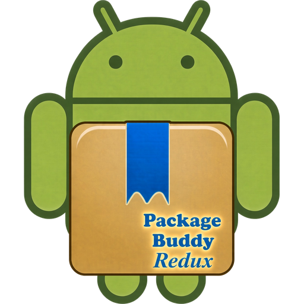
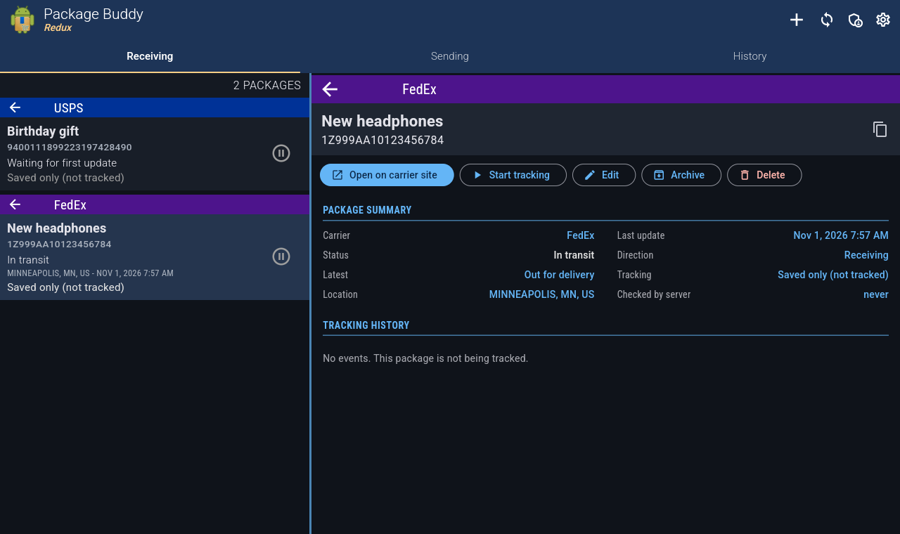
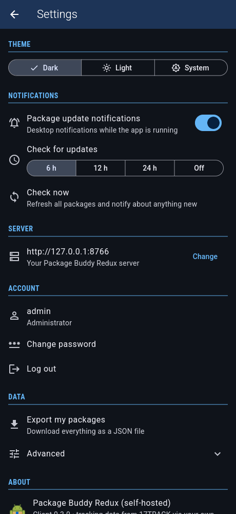
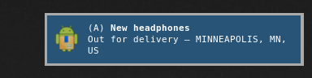

<p align="center"></p>

# Package Buddy Redux

Self-hosted package tracker: Android, Linux desktop and web, inspired by the classic Package Buddy.

You run one small server (Docker, FastAPI + SQLite). It keeps everyone's package lists and checks
every package through the [17TRACK API](https://api.17track.net/) with **your own** API key. The
Flutter app (Android, Linux desktop and a built-in web app) signs in to that server.

## Features

- **Self-hosted, one container.** All data lives in one SQLite file in the `/data` volume.
- **Any carrier 17TRACK supports** (UPS, FedEx, DHL, Royal Mail, Canada Post, China Post, ...), with
  carrier auto-detection and an "Open on carrier site" link for every package.
- **Classic layout:** Receiving / Sending / History tabs, carrier-coloured headers, event timeline.
  Dark mode by default; Light and System themes too.
- **Android notifications without Firebase:** the phone checks your server in the background every
  6, 12 or 24 hours (or Off) and shows one notification per package with the latest event. Tap it to
  open the package. Survives reboots.
- **Linux desktop app** (.deb for Debian, Ubuntu and Mint) with desktop notifications while it runs.
- **Web app built into the server:** open `http://SERVER:8765/` in any browser.
- **Multi-user:** accounts, admin area, optional approvals and monthly limits, long-lived API tokens.
- **17TRACK quota protection:** each number is registered once, no matter how many people track it.
- **Import from the old app** (adb backup, XML backup or database), optional.

## Screenshots

All screenshots use test data only.

| Desktop | Notification settings | Desktop notification |
|---|---|---|
|  |  |  |

---

## Server setup

You need a Linux server with Docker (and optionally Portainer), and a 17TRACK API key
(free plan works; create one at <https://api.17track.net/>).

### 1. Get the code and build the image

Either download `packagebuddy-server.tar.gz` from the
[latest release](https://github.com/Gavinvox/package-buddy-redux/releases/latest) (it already
contains the built web app), or clone this repo. If you clone, build the web app first with
`./build_web.sh` (needs Flutter); without it the server still works but shows a placeholder page at `/`.

```
tar xzf packagebuddy-server.tar.gz
```

```
cd packagebuddy-server && sudo docker build -t packagebuddy-server:latest .
```

### 2a. Docker Compose (no Portainer)

```
cp .env.example .env && nano .env && sudo docker compose up -d
```

Fill in `TRACK17_API_KEY` and `ADMIN_PASSWORD` in `.env`. Never commit `.env`.

### 2b. Portainer: plain container

1. **Containers > + Add container**. Name `packagebuddy`, image `packagebuddy-server:latest`,
   turn **Always pull the image** off.
2. Port mapping: host `8765` to container `8765`.
3. Volumes: map volume `packagebuddy-data` to container path `/data`.
4. Env: `TRACK17_API_KEY`, `ADMIN_USERNAME`, `ADMIN_PASSWORD` (and any settings below).
5. Restart policy: **Unless stopped**. Deploy.

### 2c. Portainer: stack

**Stacks > + Add stack**, name `packagebuddy`, **Web editor**, paste `portainer-stack.yml`, add the
environment variables (`TRACK17_API_KEY`, `ADMIN_USERNAME`, `ADMIN_PASSWORD`, ...) and click
**Deploy the stack**.

### 3. Open it

Go to `http://SERVER-IP:8765/` and sign in with the admin account. API docs are at `/docs`.

### Updating

Unpack the new tarball (or `git pull`), rebuild the image with the same `docker build` line, then:

- **Plain container:** Containers > packagebuddy > **Recreate** (leave "Pull latest image" off).
- **Stack:** Stacks > packagebuddy > Editor > **Update the stack** (leave "Re-pull image" off).
- **Compose:** `sudo docker compose up -d --force-recreate`

Your data in the `packagebuddy-data` volume stays.

### Remote access with a Cloudflare Tunnel

To use the apps away from home without opening ports, publish the server through a
[Cloudflare Tunnel](https://developers.cloudflare.com/cloudflare-one/connections/connect-networks/):
add a public hostname such as `pb.example.com` pointing to `http://packagebuddy:8765` (if
`cloudflared` runs in the same Docker network) or `http://SERVER-IP:8765`. Then use
`https://pb.example.com` as the server address in the apps. Keep `ALLOW_SIGNUP=false` on a public
hostname; the admin creates accounts.

## Settings (environment variables)

| Variable | Default | What it does |
|---|---|---|
| `TRACK17_API_KEY` | (required) | Your 17TRACK API key. Never shown by the server. |
| `ADMIN_USERNAME` / `ADMIN_PASSWORD` | | Creates the first admin on first start only. Changing them later does nothing; use the API to change passwords. |
| `POLL_INTERVAL_MINUTES` | 60 | How often all active packages are checked (minimum 5). Checking is free; only adding new numbers uses quota. |
| `ALLOW_SIGNUP` | false | If true, anyone who can reach the server can create an account. Leave false and create accounts as admin. |
| `AUTO_ARCHIVE_DAYS` | 7 | Delivered packages move to History after this many days. |
| `REQUIRE_APPROVAL` | false | If true, a new number added by a non-admin waits for admin approval before using quota. |
| `MONTHLY_NEW_NUMBERS_PER_USER` | 0 | Max new numbers per user per month (0 = no limit). Admins can set a per-user value. |
| `DISABLE_REGISTRATION` | false | Safety switch: the server never registers anything with 17TRACK (no quota can be used). |
| `RETRY_UNSUPPORTED_HOURS` | 24 | How often to retry numbers 17TRACK refused (USPS today), in case 17TRACK starts accepting them. |
| `SESSION_DAYS` | 30 | How long an app login lasts. API tokens can be permanent. |
| `WEB_DIR` | `app/web` | Folder with the built web app. Only change this for development. |

`REQUIRE_APPROVAL`, `MONTHLY_NEW_NUMBERS_PER_USER`, `AUTO_ARCHIVE_DAYS` and `ALLOW_SIGNUP` can also be
changed while running with **PATCH /api/v1/admin/settings**.

---

## How quota is protected

17TRACK's free plan allows a fixed number of tracking numbers in total. Checking a number that is
already registered is free. The server:

- registers each number once, no matter how many users track it;
- at start-up reads the list of numbers already on your 17TRACK account (for example ones added by
  another tool), so those are never registered again (**POST /api/v1/admin/sync-account** does it on demand);
- never registers History items when importing an old backup, and only registers active items if
  you ask for it (`track_active=true`); `dry_run=true` shows what an import would do;
- stops 17TRACK updates (`stoptrack`, not delete) for delivered packages once they are in History,
  or when nobody tracks the number any more, but **only for numbers this server registered itself**.
  Numbers that were already on the account  are never stopped. Restoring one from History restarts it (17TRACK allows
  this once per number);
- shows the live quota and who used what at **GET /api/v1/admin/quota**.

## Amazon and USPS

Both go through 17TRACK like everything else, in case 17TRACK fixes them. Right now:

- **USPS**: 17TRACK refuses USPS on the free plan. These packages show the state
  `carrier_unsupported` with a note. No quota is used. The server retries once a day.
- **Amazon (TBA...)**: Amazon shares no data with 17TRACK, so these show `carrier_unsupported`.

Every package has a `carrier_site_url` ("Open on carrier site"), for example
`https://track.amazon.com/tracking/TBA...` or the USPS tracking page.

## Package states

`pending`, `info_received`, `in_transit`, `out_for_delivery` (also "ready for pickup"), `delivered`,
`exception` (failed delivery, returned, customs hold...), `not_found`, `expired`,
`carrier_unsupported`. Each package also has a readable `state_label`, the latest `status_text`,
`last_location`, `eta`, `days_in_transit`, `delivered_at`, and the cached `events` list.

`tracking_mode` says whether the server is tracking it: `tracked`, `not_tracked` (saved or imported
only), `awaiting_approval`, or `rejected`.

## Importing from the old app

Optional; you don't need it for a fresh start. In the app it is tucked away under **Settings > Advanced >
Import from the old Package Buddy app**. Pick the file, check the preview, then tap **Import**. The preview
shows how many items are active or history and, if you tick **Track active items**, how many new
17TRACK numbers that would use. History items are never registered.

- **Android backup (.ab), recommended.** The old app's own backup no longer works, so take a backup
  with adb. On a PC with `adb` installed and USB debugging on the phone, run (copy just this line):

  ```
  adb backup -f packagebuddy.ab com.psyrus.packagebuddy
  ```

  On the phone tap **Back up my data** and **leave the password empty** (encrypted backups can't be
  read and are refused with a clear message). Import `packagebuddy.ab` in the app, or with
  **POST /api/v1/import/adb**. Compressed and uncompressed backups both work; the server finds
  `apps/com.psyrus.packagebuddy/db/packagebuddy_db` inside it.
- **Backup file**: in the old app, Settings > Account/Data > Save Data to Device. The file is
  `Android/data/com.psyrus.packagebuddy.backup/tracking_list_bkp.xml` on the phone. Upload it with
  **POST /api/v1/import/xml**.
- **Database file** (`packagebuddy_db`): **POST /api/v1/import/sqlite**.
- **Any of the above**: **POST /api/v1/import** detects the file type itself (this is what the app uses).

Old carrier codes are mapped to 17TRACK codes where a match exists (69 of the 127 old carriers; the
rest were small or defunct carriers and are imported without a carrier). Old status, location and
event history are kept. Synthetic examples are in `samples/`.

## API overview (all under `/api/v1`, full details at `/docs`)

| Area | Endpoints |
|---|---|
| Auth | `POST /auth/login`, `POST /auth/logout`, `POST /auth/signup`, `GET /me`, `POST /me/password` |
| Tokens | `GET /tokens`, `POST /tokens` (long-lived, e.g. for scripts or an AI assistant), `DELETE /tokens/{id}` |
| Packages | `GET /packages?view=active|history|all&direction=receiving|sending&q=`, `POST /packages`, `GET/PATCH/DELETE /packages/{id}`, `GET /packages/{id}/events`, `POST /packages/{id}/refresh`, `POST /packages/{id}/track`, `POST /packages/refresh` (refresh all of mine, free) |
| Changes | `GET /changes?since_id=` (feed for notifications) |
| Carriers | `GET /carriers?q=&all=`, `GET /carriers/detect?number=` |
| Import/export | `POST /import` (auto-detect), `POST /import/adb`, `POST /import/xml`, `POST /import/sqlite`, `GET /export` |
| Admin | `GET/POST /admin/users`, `PATCH/DELETE /admin/users/{id}`, `GET /admin/quota`, `GET/PATCH /admin/settings`, `GET /admin/approvals`, `POST /admin/approvals/{id}/approve|reject`, `POST /admin/poll-now`, `POST /admin/sync-account`, `GET /admin/poller` |
| Health | `GET /health` |

Send tokens as `Authorization: Bearer <token>` (or an `X-API-Key: <token>` header).

## Android app

1. Download `packagebuddy-redux-arm64.apk` from the
   [latest release](https://github.com/Gavinvox/package-buddy-redux/releases/latest) and open it on the
   phone (allow installs from your browser/file manager when asked).
2. On the sign-in screen tap **Server address** and enter `http://SERVER-IP:8765` or
   `https://pb.example.com`.
3. **Settings > Notifications**: allow notifications and pick 6 h, 12 h, 24 h or Off.

The release APK is signed with a debug key. Android will only update it with an APK signed by the
same key, so if you build your own, uninstall first.

**Battery note:** Android decides when background work actually runs; checks can be late,
especially in Doze. If notifications are slow, use the **Fix** button in Settings (or set the app's
battery usage to **Unrestricted**). Force-stopping the app stops checks until it is opened again.

## Linux desktop app (.deb)

For Debian 12+, Ubuntu 22.04+ and Linux Mint 21+ (amd64). Download the `.deb` from the release, then:

```
sudo apt install ./packagebuddy-redux_0.3.0_amd64.deb
```

Start **Package Buddy Redux** from the menu and enter your server address. Desktop notifications are
shown while the app is running. Remove with `sudo apt remove packagebuddy-redux`.

## Building from source

The client is Flutter (tested with Flutter 3.47 / Dart 3.13) in `client/`.

- **Web:** `./build_web.sh` builds the web app into `app/web` (served by the server).
- **Android:** `cd client && flutter build apk --release --split-per-abi`
- **Linux:** `cd client && flutter build linux --release`
  (needs `clang cmake ninja-build pkg-config libgtk-3-dev`).
- **.deb:** `packaging/debian/build-deb.sh` after the Linux build, or the one-shot
  `packaging/debian/build-on-mint.sh`. Build on the oldest distro you want to support (glibc).

### Server development

```
python3 -m venv .venv && . .venv/bin/activate && pip install -r requirements-dev.txt && pytest -q
```

Tests use a fake 17TRACK and never contact the real service. Sample import files are generated
from `samples/make_samples.py` (all numbers in them are made up).

### Optional: Open WebUI tool

`tools/openwebui/` has an [Open WebUI](https://openwebui.com/) tool that lets a local AI model query
17TRACK directly. See `tools/openwebui/SETUP.md`. It needs its own 17TRACK key set in the tool's
settings; no key is included.

## Credits and notice

Package Buddy Redux is an independent clean-room rebuild inspired by Package Buddy by
Psyrus/Partial Software; not affiliated.

The Android robot is reproduced or modified from work created and shared by Google and used
according to terms described in the Creative Commons 3.0 Attribution License.

Tracking data comes from the [17TRACK API](https://api.17track.net/); each user supplies their own
API key. Not affiliated with 17TRACK.

Fonts: Roboto and Roboto Condensed (SIL Open Font License, see `client/assets/fonts`).

## License

[MIT](LICENSE) - Copyright (c) 2026 Gavinvox
